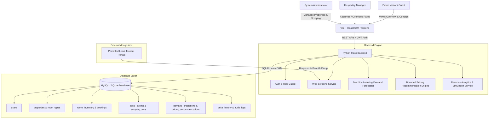

# System Architecture Documentation

## 1. Overview
The **Predictive Dynamic Pricing and Revenue Management System for Eco-Tourism Hospitality** is an end-to-end decision-support web platform engineered to help nature retreats, eco-lodges, and sustainable homestays optimize room rates ethically while protecting environmental carrying capacity.

## 2. Core Subsystems

### A. Frontend Layer (Single Page Application)
- **Framework**: React 19 with Vite 8.
- **Styling**: Tailwind CSS with custom curated eco palette (forest greens, sage neutrals, earthy tones).
- **Navigation**: React Router v7 with role-based protected route wrappers (`/dashboard/*`).
- **Data Visualization**: Recharts rendering interactive Area, Line, and Bar charts for demand vs actual occupancy, ADR, RevPAR, and revenue simulations.
- **Iconography**: Lucide React.

### B. REST API Backend
- **Framework**: Python Flask 3.0+ structured cleanly into modular blueprints (`auth_bp`, `property_bp`, `event_bp`, `pred_bp`, `recommendation_bp`, `analytics_bp`, `data_bp`).
- **Security**: PyJWT token-based stateless authentication, bcrypt password hashing, and role checks (`administrator` vs `hospitality_manager`).
- **Resilience**: Configured with dual database connection: automatically connects to MySQL if configured, and provides immediate zero-config SQLite fallback so the application runs seamlessly out-of-the-box in any demo environment.

### C. Web Scraping & Event Intelligence Engine
- **Libraries**: Python `requests` and `beautifulsoup4`.
- **Functionality**: Extracts upcoming festivals, bio-diversity conventions, and eco-marathons from configurable tourism sources. Normalizes dates, locations, expected footfall, and impact intensities while preventing duplicates.
- **Compliance**: Respects rate limits, timeouts, and terms of service. Labeled sample catalog prevents downtime if external portals are offline.

### D. Machine Learning Demand Forecaster
- **Library**: Scikit-learn (`RandomForestRegressor`).
- **Features**: 15 input features spanning day-of-week, weekend indicator, seasonal weight, event proximity, event intensity score, lead-time days, base price, and current occupancy.
- **Methodology**: Chronological train-validation split (no data leakage). Evaluated against a historical median baseline with MAE and RMSE metrics.

### E. Bounded Dynamic Pricing Engine
- Translates demand forecast into optimal room rates using a transparent formula:
  $$\text{Recommended Rate} = \text{Base Price} \times (1 + \Delta_{\text{Demand}} + \Delta_{\text{Event}} + \Delta_{\text{Season}} + \Delta_{\text{Weekend}})$$
- Strictly bounds pricing within property physical constraints:
  $$\text{Min Rate Floor} \le \text{Recommended Rate} \le \text{Max Rate Ceiling}$$
- Requires explicit hospitality manager confirmation before applying new rates to room inventory.
