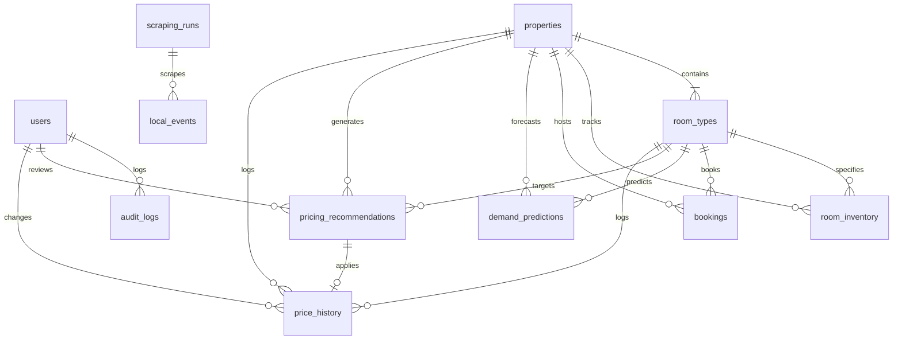

# Database Schema & Relational Structure

## Relational Entity-Relationship Diagram

## Table Specifications

### 1. `users`
- Stores authentication credentials and role assignments.
- Primary Key: `id` (Auto-increment integer).
- Attributes: `username` (unique), `email` (unique), `password_hash` (bcrypt), `full_name`, `role` (`administrator` or `hospitality_manager`), `is_active`, `created_at`, `updated_at`.

### 2. `properties`
- Core entity representing eco-tourism hospitality sanctuaries.
- Attributes: `name`, `location`, `state_or_region`, `eco_category`, `base_price`, `min_price`, `max_price`, `total_capacity`, `sustainability_rating` (1.0 to 5.0), `is_active`.

### 3. `room_types`
- Room categories under a property (e.g. Canopy Treehouse, Bamboo Cottage).
- Foreign Key: `property_id` -> `properties.id`.
- Attributes: `name`, `capacity`, `base_price`, `min_price`, `max_price`, `total_rooms`, `amenities`.

### 4. `room_inventory`
- Daily calendar tracking available, booked, and current rates per room type.
- Unique Constraint: `(room_type_id, inventory_date)`.
- Attributes: `inventory_date`, `total_rooms`, `available_rooms`, `booked_rooms`, `current_price`, `is_blocked`.

### 5. `bookings`
- Reservation records with guest details, lead times, and room price.
- Attributes: `booking_code` (unique), `guest_name`, `guest_email`, `check_in_date`, `check_out_date`, `num_guests`, `rooms_booked`, `price_per_night`, `total_price`, `booking_status`, `lead_time_days`.

### 6. `local_events` & `scraping_runs`
- Extracted local festival and tourism events.
- Attributes: `title`, `location`, `event_category`, `start_date`, `end_date`, `expected_footfall`, `impact_intensity` (`low`, `medium`, `high`, `peak`), `source_url`, `collection_method` (`scraped`, `manual`, `verified_feed`).

### 7. `demand_predictions` & `model_training_runs`
- Predictions outputted by Scikit-learn alongside active model evaluation runs.
- Attributes: `predicted_demand` (rooms), `predicted_occupancy_rate` (%), `confidence_score`, `influencing_factors` (JSON), `model_version`.

### 8. `pricing_recommendations` & `price_history`
- Human-in-the-loop dynamic rate recommendations.
- Attributes: `current_price`, `recommended_price`, `absolute_diff`, `percent_diff`, `rationale`, `min_price_enforced`, `max_price_enforced`, `status` (`pending`, `approved`, `rejected`, `applied`), `reviewed_by_id`, `override_price`.

### 9. `audit_logs`
- Immutable traceability of administrative actions, price adjustments, and system scraping executions.
